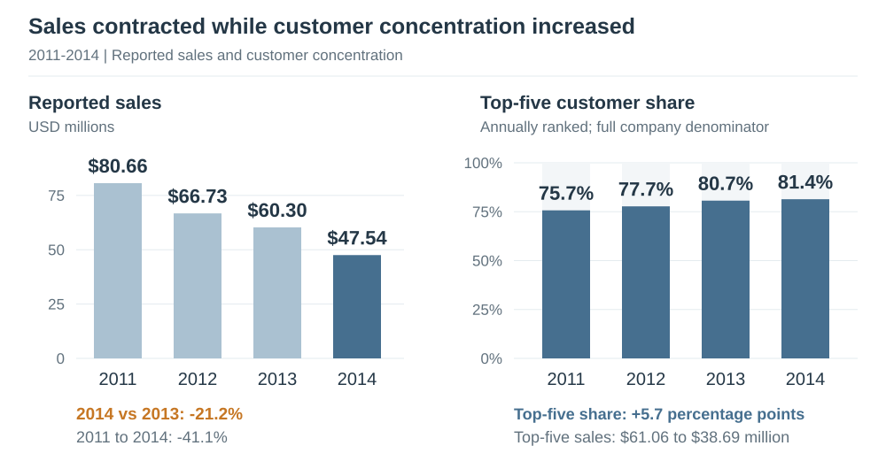
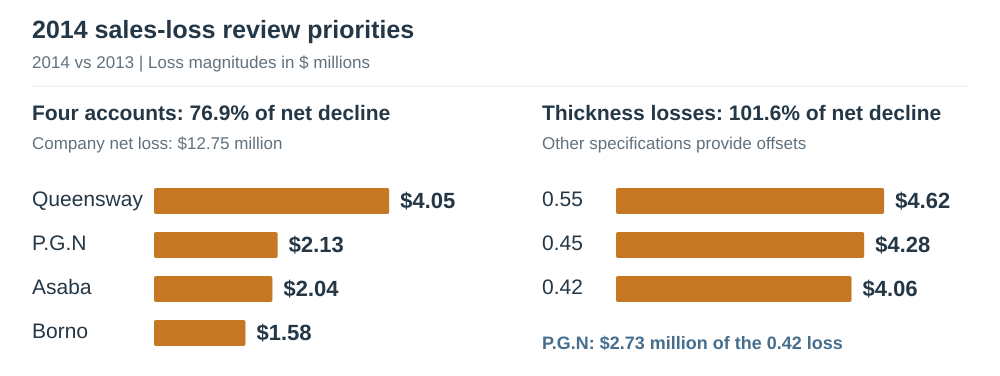
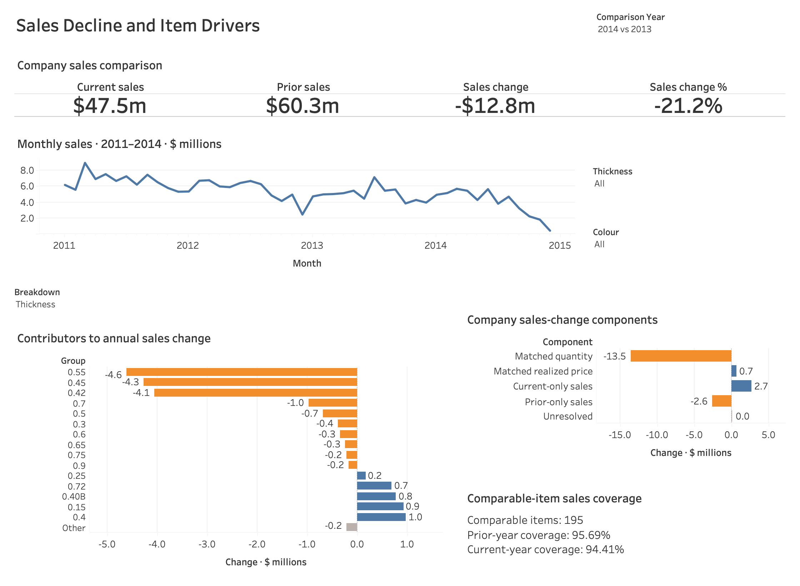
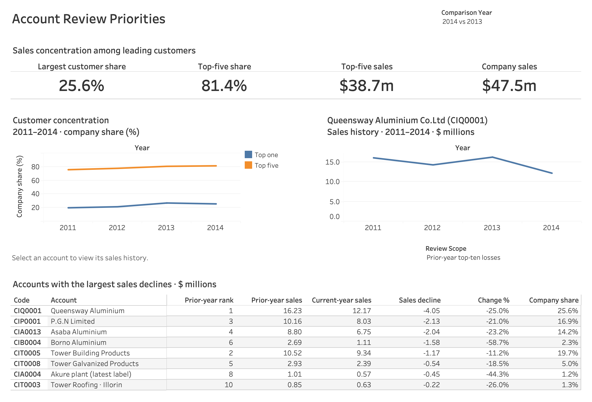

<h1 align="center">Manufacturing Sales Decline and Account Concentration</h1>

<strong>2011–2014 · Commercial review priorities</strong>

<a href="tableau/manufacturing_sales.twbx">Tableau workbook</a> · <a href="sql/README.md">SQL analysis</a>

## Project background

This historical case study examines an aluminium manufacturer's
reported sales decline over 2011–2014. It helps a **sales or commercial manager**
focus attention on the customers and
product specifications contributing most to the decline, 
while assessing dependence on major customers. 

The data covers **62,005 sales lines across 84 customer accounts from 2011–2014**.

## Executive summary

**Sales fell 41% from 2011 to 2014, reaching $48 million.** In 2014, sales declined 21%, or $13 million, compared with 2013.

- **Four accounts make up 77% of the 2013–2014 net decline.** Sales to Queensway, P.G.N, Asaba and Borno fell by a combined $10 million, making these accounts commercial priorities.
- **Product losses are concentrated in three thickness labels.** Sales for 0.55, 0.45 and 0.42 fell by a combined $13 million in 2014 versus 2013, with gains in other specifications partly offsetting these losses.
- **Dependence on major customers increased as sales contracted.** Top-five customer share rose from **76% to 81%**, while sales to these customers fell from **$61 million to $39 million**.

**Priority:** investigate purchasing changes at the four accounts with the largest sales losses, review the largest losses in product specifications, and track major-customer sales alongside customer concentration.

*Top-five share refers to the five largest customers in each year. [Source annual sales (NGN)](reports/company_year.csv) · [Concentration](reports/concentration_year.csv).*

## Insights deep-dive

### 1. Four accounts make up 77% of the annual net decline

Between 2013 and 2014, sales declined for **40 of the 59 accounts** with recorded activity in either year. Queensway alone contributed **32% of the company's net decline**, following a **25% fall in sales**. Borno's **59% decline** was the steepest among the four priority accounts. Queensway therefore warrants attention for the scale of its loss, while Borno warrants attention for the severity of its contraction.

### 2. Product losses are concentrated in three thickness labels

In 2014 compared with 2013, sales for thickness labels **`0.55`, `0.45` and `0.42` fell by a combined $13 million**, partly offset by gains in other specifications. P.G.N accounted for **67% of the `0.42` loss**, but its sales increased for `0.4`, `0.40B` and `0.55`. Growth in those specifications softened the account's overall decline. The different trends within P.G.N make its product mix useful for understanding the loss.

*The panels group the same sales records by customer and thickness.
[Specification evidence](reports/revenue_driver_details.csv).*

### 3. Dependence rises while major-account sales fall

The increase in customer dependence is also visible when following the same accounts across years. Sales to the **five largest customers of 2011 fell 39% by 2014**, while sales outside that group fell **48%**. Those original major customers consequently accounted for **79% of company sales in 2014**, up from **76% in 2011**. Sales elsewhere contracted faster, causing more dependence on a major-customer group whose sales are also falling.

## Recommendations

1. **Develop individual plans for the four priority accounts.** Use the item and monthly sales histories to identify which purchases declined at Queensway, P.G.N, Asaba and Borno. Discuss current requirements, upcoming purchases and service concerns with each customer, then agree on a specific next step. Review monthly account sales against the same period in the previous year.

2. **Review changing specification requirements at priority customers.** Start with P.G.N's declining `0.42` sales and the specifications showing growth. Discuss whether requirements changed or purchases moved between products, using order, quotation and contract history to understand the pattern. Match subsequent product offers to the customer's confirmed requirements. Apply the same customer specific approach to the largest contributors to the company's `0.55` and `0.45` losses.

3. **Use customer exposure to guide commercial priorities.** Review contract renewals and purchase plans for the largest customers alongside sales trends across the remaining account base. Use that information to decide where sales effort should focus on maintaining major-account business and where it should support growth in other accounts. Track absolute sales for both groups so that increasing customer share is interpreted alongside sales performance.

## Explore the Tableau dashboards

The [packaged workbook](tableau/manufacturing_sales.twbx) contains both dashboards
and all four independent CSV sources. Open it in Tableau Desktop to interact with it. The images below are captured from the Tableau workbook.

<strong>Sales Decline and Item Drivers — view dashboard</strong>

<strong>Account Review Priorities — view dashboard</strong>

## Data and interpretation limits

Source: **Ayanlowo, Bolu and Oyawale (2020)**, [Mendeley Data, version 1](https://data.mendeley.com/datasets/wynv6kmz4b/1),
DOI `10.17632/wynv6kmz4b.1`, **CC BY 4.0**.

Figures are shown in US dollars at a fixed 2014 exchange rate.

## Supporting work

**Python preparation → SQL → Tableau**

- [Supporting analysis](reports/supporting_analysis.md) · [Data dictionary](docs/data_dictionary.md)
- [SQL analysis](sql/README.md) · [Python code](src/)
